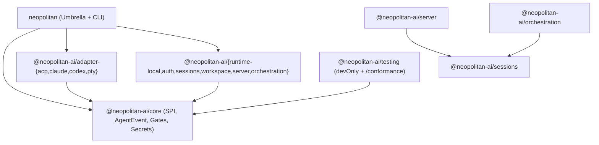

# Neopolitan

> Every coding-agent flavor in one container — headless TypeScript SDK and zero-dependency CLI for Claude Code, OpenAI Codex, ACP v1/v2 harnesses, and interactive CLIs, without Electron, Effect-TS, or vendor lock-in.

[](https://github.com/milesangelo/neopolitan/actions/workflows/ci.yml)
[](https://milesangelo.github.io/neopolitan/)
[](./LICENSE)
[](https://nodejs.org/)
[](https://www.typescriptlang.org/)

Neopolitan gives you one clean `Promise` + `AsyncIterable` + `AbortSignal` + Zod contract (`ProviderDriver` -> `ProviderAdapter` -> `AgentSession`) across coding-agent harnesses running locally, over WSL2, in Git worktrees, or behind a headless HTTP/SSE/WebSocket RPC server.

---

## 10-Second CLI Quickstart

Probe locally installed coding-agent CLIs (`claude`, `codex`, `opencode`, `agy`, `gemini`, `amp`):

```bash
npx neopolitan-ai doctor
```

Run a headless JSON/SSE/WS server or compile a cross-provider context handoff bundle:

```bash
npx neopolitan-ai serve --port 7420 --token my-secret
npx neopolitan-ai handoff --store ./.sessions --session sess-1 --to codex
```

---

## 15-Line SDK Quickstart

Install the umbrella package (or pick only the scoped `@neopolitan-ai/*` packages you need):

```bash
npm install neopolitan-ai
```

```ts
import {
  InMemoryEventStore,
  LocalExecutionRuntime,
  SessionManager,
  createDefaultRegistry,
} from 'neopolitan-ai';

const manager = new SessionManager(createDefaultRegistry(), new InMemoryEventStore(), {
  runtime: new LocalExecutionRuntime({ defaultCwd: process.cwd() }),
});

await using session = await manager.open('codex', { cwd: process.cwd() });
const receipt = await session.sendTurn({ prompt: 'Summarize the test suite failures' });

for await (const event of session.events()) {
  if (event.type === 'assistant.delta') process.stdout.write(event.text);
  if (event.type === 'turn.completed') break;
}
```

Or hand off an active session cleanly from Claude Code to Codex using the exact same `SessionManager` (see [`examples/src/01-provider-swap-handoff.ts`](./examples/src/01-provider-swap-handoff.ts)).

---

## Architecture DAG

`@neopolitan-ai/core` has zero dependency on Node process spawning, Electron, Effect-TS, or native binaries. `node-pty` is isolated strictly as an optional `peerDependency` of `@neopolitan-ai/adapter-pty`.



---

## Provider Compatibility Matrix

| Provider / CLI | Package | Transport | Resume / Fork | Approval & Elicitation Gates | Verification Level |
|---|---|---|---|---|---|
| **Claude Code** | `@neopolitan-ai/adapter-claude` | `stream-json` / native SDK | Resume + checkpoint fork | Tool & permission gating | Conformance + Wire Fixture + Live Probe |
| **OpenAI Codex** | `@neopolitan-ai/adapter-codex` | `app-server` JSON-RPC/NDJSON | Resume + tip fork | Command, file-write & user input | Conformance + Wire Fixture + Live Handshake |
| **OpenCode** | `@neopolitan-ai/adapter-acp` | ACP v1/v2 (`opencode` flavor) | `session/load` + tip fork | ACP permissions + URL/form elicitation | Conformance + Wire Fixture + Live Handshake |
| **Antigravity (`agy`)** | `@neopolitan-ai/adapter-acp` | ACP (`antigravity` flavor) | `session/load` | Never auto-approves `interaction_*` | Conformance + Wire Fixture + Live Probe |
| **Grok / Kiro / Copilot / `omp` / `pi`** | `@neopolitan-ai/adapter-acp` | ACP dialect flavors | Flavor-specific | ACP permissions + policy rules | Wire Fixture + Flavor Unit Tests |
| **Amp / Droid / Custom CLIs** | `@neopolitan-ai/adapter-pty` | Optional `node-pty` + HTTP Hooks + `OSC 7501` | Ephemeral / host hook | Coarse flags + HTTP `PermissionRequest` hold | Conformance + Wire Fixture (fake PTY) |

---

## How Neopolitan Compares

| Capability | Neopolitan | `@agentclientprotocol/sdk` | Claude Agent SDK | Vercel AI SDK |
|---|---|---|---|---|
| **ACP + Codex + Claude + PTY in one SPI** | Yes | ACP only | Claude only | HTTP model APIs only |
| **Cross-provider session handoff (`EventStore` + secret redaction)** | Built-in | No | No | App-owned |
| **Provider auth isolation & `env` scrubbing** | Built-in | DIY | Partial | API keys only |
| **Multi-repo Git worktrees + safe cleanup tiers** | Built-in (`@neopolitan-ai/workspace`) | No | No | No |
| **Non-blocking HTTP+SSE & WebSocket RPC server** | Built-in (`@neopolitan-ai/server`) | Stdio/stream only | No | Helpers only |
| **Disguised elicitation / `full_access` bypass guard** | Built-in (`GateMiddleware`) | DIY | Hook callbacks | N/A |

---

## Packages

| Package | Purpose | Link |
|---|---|---|
| `neopolitan-ai` | Umbrella exports, subpaths & CLI (`doctor`, `run`, `serve`, `handoff`) | [`packages/neopolitan`](./packages/neopolitan) |
| `@neopolitan-ai/core` | Pure TS + Zod SPI, `AgentEvent`, `EventHub`, `GateMiddleware`, `redactSecrets` | [`packages/core`](./packages/core) |
| `@neopolitan-ai/runtime-local` | `LocalExecutionRuntime` & `WslExecutionRuntime` | [`packages/runtime-local`](./packages/runtime-local) |
| `@neopolitan-ai/adapter-acp` | ACP v1/v2 client, flavor table, workspace path guard | [`packages/adapter-acp`](./packages/adapter-acp) |
| `@neopolitan-ai/adapter-claude` | Claude Code `stream-json` + auth env scrubber | [`packages/adapter-claude`](./packages/adapter-claude) |
| `@neopolitan-ai/adapter-codex` | Clean-room Codex `app-server` JSON-RPC client & hang watchdog | [`packages/adapter-codex`](./packages/adapter-codex) |
| `@neopolitan-ai/adapter-pty` | Optional `node-pty` + HTTP hooks + `OSC 7501` reducer | [`packages/adapter-pty`](./packages/adapter-pty) |
| `@neopolitan-ai/auth` | Encrypted host `SecretStore`, multi-account profiles, Bedrock/Vertex env | [`packages/auth`](./packages/auth) |
| `@neopolitan-ai/sessions` | `JsonlEventStore`, `TurnItemAccumulator`, `SessionManager`, `handoff` | [`packages/sessions`](./packages/sessions) |
| `@neopolitan-ai/workspace` | Multi-repo Git worktrees, `classifyWorktreeTier`, instruction discovery | [`packages/workspace`](./packages/workspace) |
| `@neopolitan-ai/server` | HTTP+SSE & WebSocket RPC server + client with cursor replay | [`packages/server`](./packages/server) |
| `@neopolitan-ai/orchestration` | Quota fallback engine, `A2ABroker`, peer-review loops | [`packages/orchestration`](./packages/orchestration) |
| `@neopolitan-ai/testing` | Vitest-free mocks + `@neopolitan-ai/testing/conformance` suite | [`packages/testing`](./packages/testing) |

---

## Examples & Documentation

- **Full Documentation & API Reference:** [milesangelo.github.io/neopolitan](https://milesangelo.github.io/neopolitan/)
- **AI / LLM Summary:** [`llms.txt`](./llms.txt)
- **Contributor & Agent Guide:** [`AGENTS.md`](./AGENTS.md) and [`CONTRIBUTING.md`](./CONTRIBUTING.md)
- **Runnable Examples:** See [`examples/README.md`](./examples/README.md) (`pnpm run examples:all`).

## Development

```bash
pnpm install
pnpm run lint
pnpm run check:boundaries
pnpm run typecheck
pnpm run test:coverage
pnpm run test:packed
```
